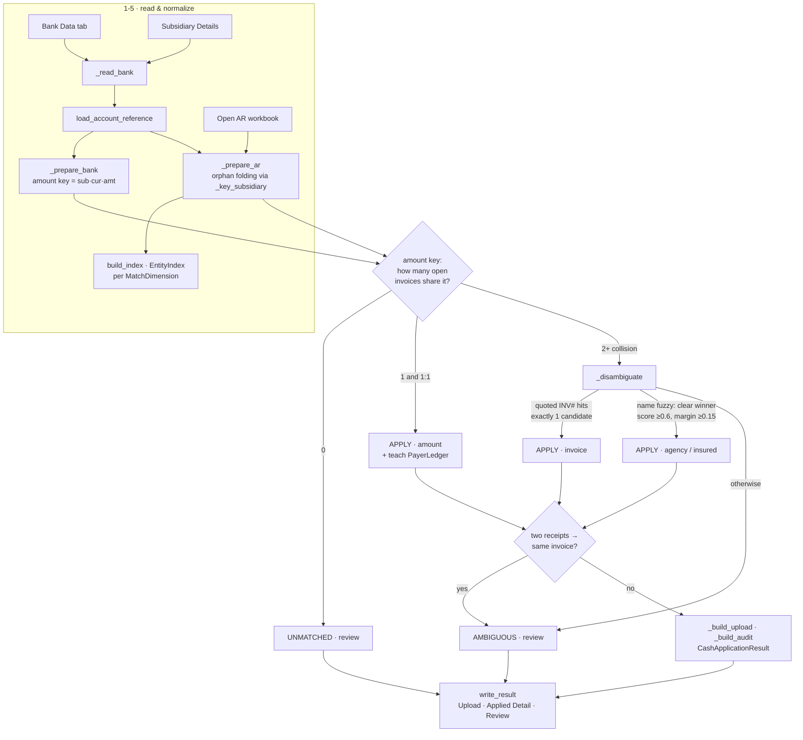

# Cash Application

Match incoming **bank receipts** to **open AR invoices** and emit the NetSuite
payment upload. The reliable signal in the data is the **amount** (with
subsidiary + currency); the payer named in the bank `Description` is a *minority*
signal (most receipts are wires/ACH that name no one), so matching is a hybrid:
an amount backbone, then a scoped disambiguation for amount collisions.

Entry point: [`run_cash_application`](pipeline.py) in `pipeline.py`.

## Modules — who owns what

| Module | Responsibility |
|---|---|
| `pipeline.py` | Orchestrates the run; owns the amount key and the apply/review decision logic |
| `reference.py` | Normalizes the two documents into a shared vocabulary (accounts, currencies, subsidiary grouping) |
| `disambiguate.py` | Matching primitives: payer / invoice-number extraction, tokenization, fuzzy scoring |
| `payer.py` | Resolving a description to a real agency/insured over the *whole* customer master (`MatchDimension`, `EntityIndex`) |
| `keys.py` | Deterministic upload IDs (`build_payment_id`) |
| `history.py` | `PayerLedger` — learned "who pays for whom" graph, committed as JSON |

## The flow

Each step lists the responsible objects/functions.

1. **Read raw inputs** — the *Bank Data* tab (the answer-key remittance column is
   dropped) and the *Subsidiary Details* tab; the open-AR workbook is read
   directly. → `_read_bank`
2. **Build the account reference** — `{"x8059": BankAccount(subsidiary=10,
   currency="CAD", …)}`. → `reference.load_account_reference`, `reference.BankAccount`
3. **Prepare the bank side** — resolve each receipt's account suffix to
   subsidiary / currency / full name and build the amount key
   `subsidiary|currency|amount`. → `_prepare_bank`, `_amount_key`,
   `reference.account_suffix`
4. **Prepare the AR side (orphan folding)** — build the same amount key per
   invoice off **Open Balance**, but first decide which subsidiary the invoice
   keys under: an *orphan* subsidiary (open AR, no bank account of its own) is
   folded onto the subsidiary that uniquely hosts its currency, so a receipt can
   see it as a candidate. → `_prepare_ar`, `_key_subsidiary`,
   `reference.currency_hosts`, `reference.account_subsidiaries`,
   `reference.normalize_currency`, `disambiguate.agency_name`
5. **Build name indexes + load ledger** — a prefix-bucketed `EntityIndex` per
   `MatchDimension` (agency, insured) over the whole customer master, and the
   learned payer graph. → `payer.build_index`, `payer.EntityIndex`,
   `payer.DIMENSIONS`, `history.PayerLedger.load`
6. **Classify each receipt** by how many open invoices share its amount key:
   - **0 candidates** → *unmatched* (review), enriched with a best guess.
   - **1:1** (one invoice, one receipt) → **apply on the amount backbone**
     (`matched_by="amount"`); also *teaches* the ledger when the description
     confidently names a different agency than the invoice's customer.
   - **collision** (2+ share the amount) → `_disambiguate`.

   → `run_cash_application` loop, `_review_row`, `payer.resolve_entity`,
   `history.PayerLedger.observe`
7. **Disambiguate a collision** (`_disambiguate`), in priority order:
   1. **Invoice number** (strongest): pull INV-tagged numbers from the
      description; if exactly one candidate's Document Number matches → apply it
      (`matched_by="invoice"`, confidence 1.0).
   2. **Fuzzy name** (fallback): score the description's payer against each
      candidate's agency `Name` and `Insured Name`; commit only if the top
      clears `DISAMBIGUATE_THRESHOLD` (0.6) **and** beats the runner-up by
      `DISAMBIGUATE_MARGIN` (0.15); otherwise → *ambiguous* (review).

   → `_disambiguate`, `disambiguate.invoice_refs`, `disambiguate.document_digits`,
   `disambiguate.extract_payer` / `normalize_tokens` / `_score`,
   `payer.score_tokens`
8. **Collision guard** — if two receipts resolved to the *same* invoice, neither
   applies; both go to review. → `run_cash_application` (inv_claims block)
9. **Assemble outputs** — the NetSuite `upload` (each row gets a deterministic,
   idempotent `build_payment_id`), the `applied_detail` audit (matched_by +
   per-dimension confidence), and review annotations; persist any newly learned
   ledger links. → `_build_upload`, `keys.build_payment_id`, `_build_audit`,
   `_with_annotations`, `CashApplicationResult`, `history.PayerLedger.save`
10. **Write to disk** (called by the CLI, not by `run_cash_application`) — Upload
    + Applied Detail + Review CSVs. The `apply-cash` CLI command finds the recent
    workbooks in Downloads and calls both. → `write_result`, `cli.apply_cash`

## Pipeline diagram



## Single-receipt decision tree

```
receipt ──amount key──▶ how many open invoices share it?
   │
   ├─ 0            → UNMATCHED (review)
   ├─ 1 (& 1:1)    → APPLY  [amount]         + teach ledger
   └─ 2+           → _disambiguate
                         ├─ quoted invoice # hits exactly 1 candidate → APPLY [invoice]
                         ├─ name fuzzy: clear winner (≥0.6, margin ≥0.15) → APPLY [agency/insured]
                         └─ otherwise → AMBIGUOUS (review)
   then: two receipts on one invoice? → both to review (collision guard)
```

## Key concepts

- **Amount key** — `subsidiary|currency|amount` (`_amount_key`). Equal keys on
  the two sides are the join. Built off the invoice's **Open Balance** (what a
  fresh receipt actually clears), not its original amount.
- **Orphan subsidiary** — a subsidiary with open AR but no bank account of its
  own (its money physically arrives in another subsidiary's account). It is
  folded onto the account-owning subsidiary that uniquely hosts its currency
  (CAD→10, GBP→16, AUD→37, DKK→59). Account-owning subs are never folded, so the
  large same-currency subsidiaries stay distinct. See `currency_hosts`.
- **Disambiguation is scoped** — an amount collision is resolved only against
  *that amount's* candidate invoices (a handful of names), so it is fast and can
  never wander to an unrelated customer in the 19K-name master.
- **Precision over recall** — a mis-applied payment is worse than one left for a
  human, so borderline cases go to review rather than being applied.
- **PayerLedger** — the *exact* (1:1) tier is ground truth, so a confident
  description agency that differs from the cleared invoice's customer is recorded
  as an observed "A pays for B" link, accumulating a graph a future cross-agency
  tier can trust.

## Running it

```bash
# via the CLI (reads the most recent matching workbooks from ~/Downloads)
uv run finance-tools apply-cash --bank "Bank Data" --ar "Open AR"

# tests
uv run --with pytest python -m pytest tests/test_cash_app.py -q
```

> **Note:** `python-calamine` is pinned `<0.8` — 0.8.x regressed on the bank
> file's corrupt workbook relationships ("Relationship not found"); 0.7.x reads
> it.
